# Day 5 – Shell Scripting Functions (Machine Test)

This repository contains my solutions to the Day 5 Shell Scripting Functions machine test. Each function was written and tested in a Bash terminal (WSL, Ubuntu) inside the `~/shellscriptingday5` directory.

## Environment

| Item | Value |
|------|-------|
| User | Ajosh |
| Host | DESKTOP-SSK364I |
| Shell | /bin/bash |
| Working directory | `~/shellscriptingday5` |

## Table of Contents

1. [welcome()](#1-welcome)
2. [hello()](#2-hello)
3. [student()](#3-student)
4. [course()](#4-course)
5. [today()](#5-today)
6. [server_info()](#6-server_info)
7. [welcome() and course() together](#7-welcome-and-course-together)
8. [create_backup()](#8-create_backup)
9. [success()](#9-success)
10. [check_docker()](#10-check_docker)
11. [student_details()](#11-student_details)
12. [check_net()](#12-check_net)
13. [system_details()](#13-system_details)
14. [Nested functions](#14-nested-functions)
15. [local_variable_demo()](#15-local_variable_demo)

---

## 1. welcome()

Displays a welcome message.

```bash
welcome()
{
echo "Welcome to Linux"
}

welcome
```

**Output**
```
Welcome to Linux
```

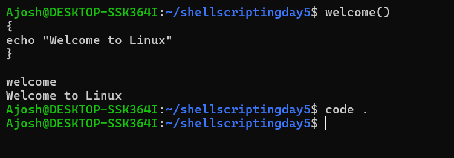

---

## 2. hello()

Defines a function and calls it three times.

```bash
hello()
{
echo "Hello Guys"
}

hello
hello; hello; hello;
```

**Output**
```
Hello Guys
Hello Guys
Hello Guys
```

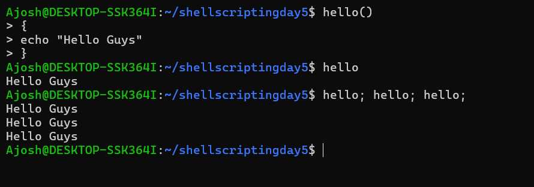

---

## 3. student()

Accepts a student name as a parameter and displays it.

```bash
student()
{
echo "Enter Student Name: $1"
}

student Sanju
```

**Output**
```
Enter Student Name: Sanju
```

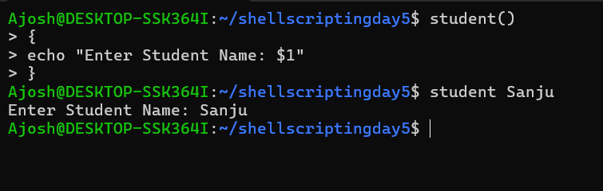

---

## 4. course()

Accepts Name and Course as parameters and displays both.

```bash
course()
{
echo "Name: $1"
echo "Course: $2"
}

course Sanju DevOps
```

**Output**
```
Name: Sanju
Course: DevOps
```

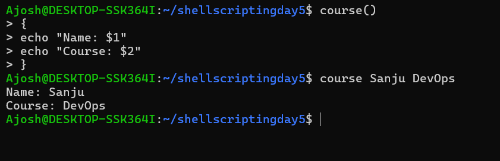

---

## 5. today()

Displays the current date and time.

```bash
today()
{
echo "Current Date & Time: $(date)"
}

today
```

**Output**
```
Current Date & Time: Sat Oct 24 06:58:34 UTC 2026
```

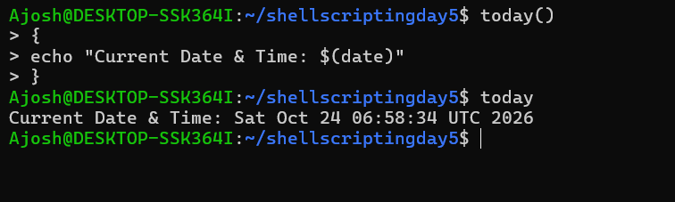

---

## 6. server_info()

Displays the current user and current directory.

```bash
server_info() {
    echo "Current User: $USER"
    echo "Current Directory: $(pwd)"
}

server_info
```

**Output**
```
Current User: Ajosh
Current Directory: /home/Ajosh/shellscriptingday5
```

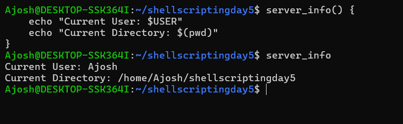

---

## 7. welcome() and course() together

Both functions are defined and then called one after another in the same line.

```bash
welcome; course;
```

**Output**
```
Welcome to Linux
Name:
Course:
```

> Note: `course` was called without arguments here, so `$1` and `$2` are empty. Passing arguments (e.g. `course Sanju DevOps`) fills in the values.

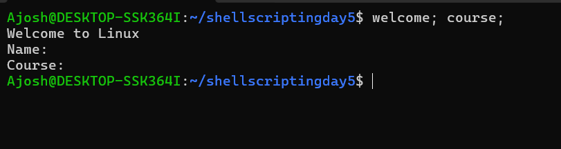

---

## 8. create_backup()

Creates a folder called `Backup` and displays a success message.

```bash
create_backup()
{
mkdir Backup
echo "Backup folder created successfully"
}

create_backup
ls
```

**Output**
```
Backup folder created successfully
Backup
```

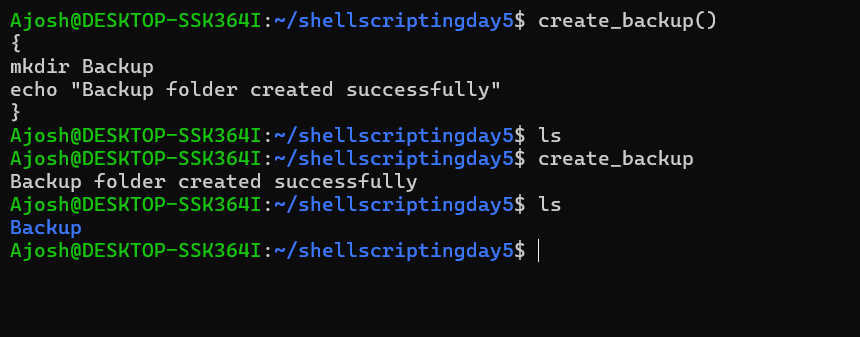

---

## 9. success()

Returns `0` and displays the return status using `$?`.

```bash
success()
{
    return 0
}

success
echo "Return status: $?"
```

**Output**
```
Return status: 0
```

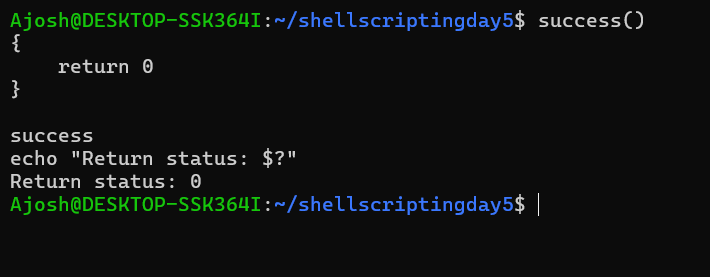

---

## 10. check_docker()

Checks whether Docker is installed and displays the result.

```bash
check_docker()
{
if command -v docker >/dev/null 2>&1; then
echo "Docker Installed"
else
echo "Docker is Not Installed"
fi
}

check_docker
```

**Output**
```
Docker Installed
```

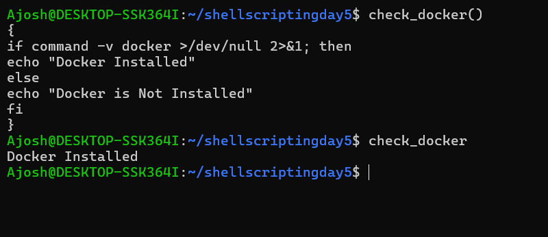

---

## 11. student_details()

Accepts Name, Course, and Batch as parameters and displays all three.

```bash
student_details()
{
echo "Name: $1"
echo "Course: $2"
echo "Batch: $3"
}

student_details Sanju DevOps 2026
```

**Output**
```
Name: Sanju
Course: DevOps
Batch: 2026
```

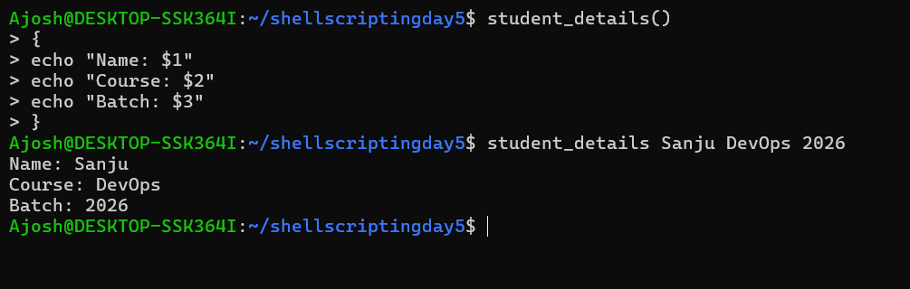

---

## 12. check_net()

Checks internet connectivity using `ping -c 1`.

```bash
check_net() { if ping -c 1 google.com >/dev/null 2>&1; then echo "Internet is Connected"; else echo "No Internet Connection"; fi }

check_net
```

**Output**
```
Internet is Connected
```

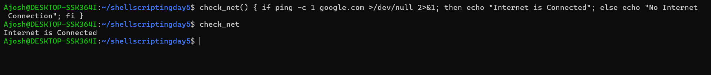

---

## 13. system_details()

Displays the username, shell name, and hostname.

```bash
system_details()
{
echo "Username: $USER"
echo "Shell Name: $SHELL"
echo "Hostname: $(hostname)"
}

system_details
```

**Output**
```
Username: Ajosh
Shell Name: /bin/bash
Hostname: DESKTOP-SSK364I
```

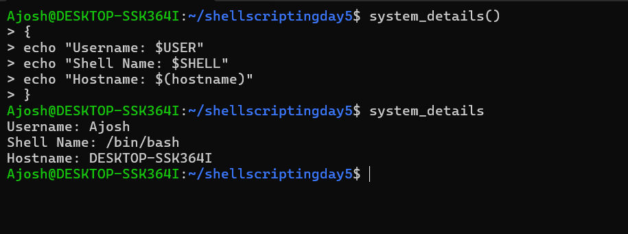

---

## 14. Nested functions

A function that calls another function, displaying output from both.

```bash
inner_function()
{
echo "This is the inner function"
}

outer_function()
{
inner_function
echo "This is the outer function"
}

outer_function
```

**Output**
```
This is the inner function
This is the outer function
```

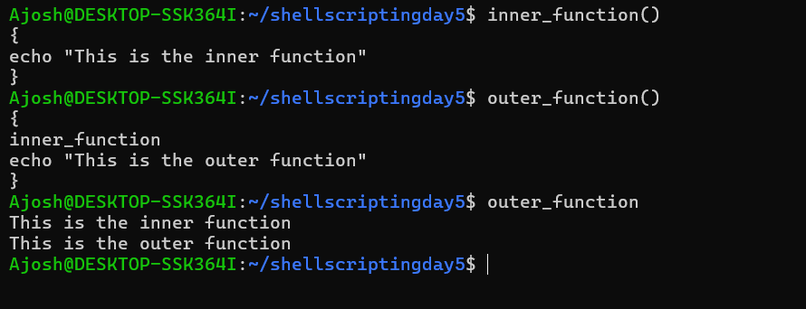

---

## 15. local_variable_demo()

Uses a local variable inside a function and displays its value.

```bash
local_variable_demo() {
    local msg="I am a local variable"
    echo "$msg"
}

local_variable_demo
```

**Output**
```
I am a local variable
```

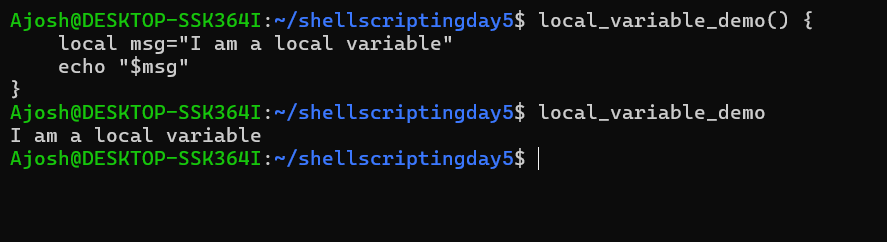

---

## Key Concepts Covered

- **Function definition:** `name() { commands; }`
- **Calling a function:** use its name only, without parentheses
- **Parameters:** accessed inside the function as `$1`, `$2`, `$3`
- **Return status:** `return 0` sets the status, read immediately with `$?`
- **Local variables:** declared with `local`, visible only inside the function
- **Command substitution:** `$(date)`, `$(pwd)`, `$(hostname)`
- **Conditionals:** `if ...; then ...; else ...; fi`
- **Output redirection:** `>/dev/null 2>&1` hides command output
- **Nested calls:** one function can call another

## Folder Structure

```
shellscriptingday5/
├── README.md
├── Backup/
└── screenshots/
    ├── welcome.png
    ├── hello.png
    ├── student.png
    ├── course.png
    ├── today.png
    ├── server_info.png
    ├── functioncall.png
    ├── create_backup.png
    ├── success.png
    ├── check_docker.png
    ├── student_details.png
    ├── check_net.png
    ├── system_details.png
    ├── nested_function.png
    └── local_variable_demo.png
```

> Place the screenshots in a `screenshots/` folder next to this README so the images display correctly.
